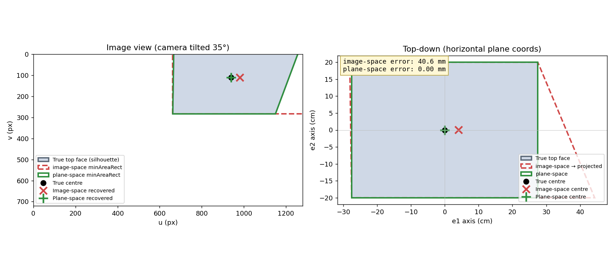
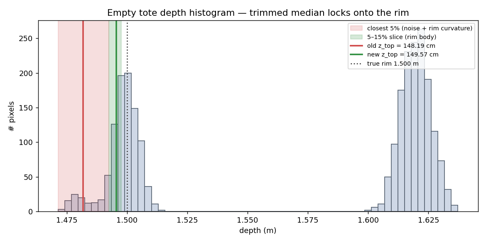
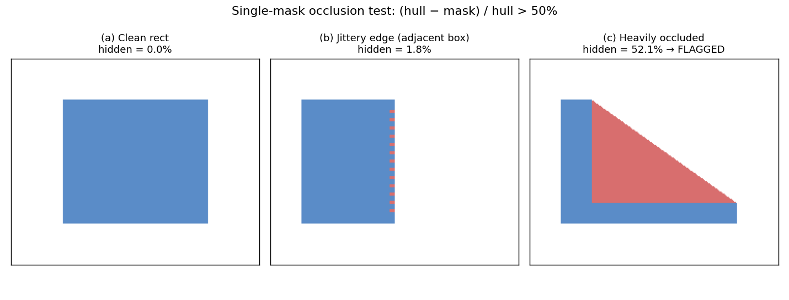

# lee4 — 객체 윗면 중심 탐지 개발일지

작성일: 2026-05-21

## 1. 목표

팔레트 위에 고정된 RGB-D 카메라로 디팔레타이징 대상(Box / Tote / Shrink Wrap)을 인식하고,
각 객체의 **윗면 기하학적 중심 + 윗면 장/단축 방향**을 3D 좌표로 산출한다.
로봇 흡착 그리퍼의 픽 좌표·자세로 직접 사용 가능한 형태가 목표.

입력: RGB(1280×720), depth(metric), IMU 가속도(world-up)
출력: 객체별 `center_3d`, `long_axis_3d`, `short_axis_3d`, 변 길이(mm)

## 2. 시스템 구성

```
RGB-D 카메라 (RealSense D456 / Orbbec Femto Bolt, 자동 감지)
        │  color, depth_m, intrinsics, accel
        ▼
RFDETRSegMedium  ──►  instance masks (0=Box, 1=Tote, 2=Wrap)
        │
        ▼
estimate_top_face()      ◄── 본 일지의 핵심 알고리즘
        │
        ▼
mask-기반 occlusion 필터 ── 자기 hull 대비 50% 이상 가려진 검출은 드롭
        │
        ▼
2D HUD (cv2.imshow)  +  3D 스냅샷 (plotly, 별도 키)
```

운영 흐름:
- **수동 트리거** — 'd' 키 또는 첫 프레임에만 추론 실행 (CPU 추론 ~700ms 비용을 매 프레임 낼 필요 없음). 카메라 디스플레이는 30 FPS 그대로.
- 'v' = 3D 포인트클라우드 스냅샷, 'c' = 화면 오버레이 클리어, 't' = SAM 액티브 러닝 라벨링, 'q' = 종료.

## 3. 알고리즘 진화 요약

| 단계 | 방식 | 트리거된 문제 |
|---|---|---|
| v0 | 마스크 픽셀 백프로젝션 → **RANSAC plane fit** → plane 위 minAreaRect | 빈 Tote 내부 바닥이 더 넓은 평면이라 잘못 fit, Shrink Wrap은 inlier 부족 |
| v1 | + Top-layer band, per-class 처리 | 토트박스에서 inlier 매우 적음 / 거리/각도 케이스마다 튜닝 폭증 |
| v2 | **mask-first** — image-space minAreaRect 4코너를 horizontal plane으로 ray-project | RANSAC 의존 제거. 단 카메라가 기울거나 박스가 광축에서 벗어나면 perspective 왜곡으로 중심 어긋남. 빈 Tote는 5%ile median이 림 곡면/노이즈에 들떠 평면이 림보다 위에 잡힘 |
| v3 | + **5–15% trimmed median**, occlusion을 자기 hull 기준으로 단순화 | 빈 Tote 평면 위치 정확해짐. 단 perspective 문제 잔존 |
| **v4 (현재)** | **plane-space minAreaRect** — contour를 horizontal plane으로 먼저 떨어뜨린 뒤 평면 안에서 minAreaRect | 카메라 기울임/오프축 무관하게 sub-mm 정확도 |

## 4. 최종 알고리즘 (v4)

```
       mask (HxW bool)        depth_m (HxW float)        up_dir (IMU)
            │                       │                         │
            ▼                       ▼                         │
   largest contour          mask 픽셀 depth 분포               │
            │                       │                         │
            │            5–15% trimmed median → z_top         │
            │                       │                         │
            │                       ▼                         │
            │            anchor 픽셀 → P_top (3D)              │
            │                       │                         │
            │                       └──────► horizontal plane◄┘
            │                                  (up_dir, P_top)
            │
            └──► contour 픽셀별 ray ∩ plane → 3D point cloud
                                │
                                ▼
                  plane 내 직교 기저 (e1, e2)로 2D 좌표화
                                │
                                ▼
                       cv2.minAreaRect (plane space)
                                │
                                ▼
                     4 코너 → 3D 리프트 (P_top + u·e1 + v·e2)
                                │
                                ▼
                center_3d = 코너 평균,  axes/dims = 코너 변
```

### 4.1. 왜 plane-space minAreaRect인가

image-space에서 `minAreaRect`를 먼저 잡고 4코너만 ray-project하면, 카메라가 기울거나 박스가 광축에서 벗어났을 때 image space silhouette이 사다리꼴이 되고, 그 사다리꼴을 감싸는 회전 직사각형은 외곽으로 부풀어버린다. 이 부푼 코너 4개를 plane으로 projection하면 실제 박스 모서리보다 더 큰 직사각형이 되며 그 중심이 한쪽으로 치우친다.

contour 픽셀을 **먼저** plane으로 떨어뜨린 뒤 평면 안에서 minAreaRect를 잡으면 perspective 왜곡이 자동 보정된다. 림 포인트 밀도에 무관하므로 거리 분기(RANSAC vs mask-first) 같은 분기 알고리즘 없이 단일 경로로 통일된다.



좌: image space. silhouette(파랑)을 감싸는 image-space `minAreaRect`(빨강 점선)는 사다리꼴 외곽으로 부풀고, 그 코너를 plane으로 떨어뜨려 평균을 잡으면 중심이 어긋난다.
우: 같은 결과를 horizontal plane에서 본 모습. image-space 방식은 평면 위에서 실제 박스(파랑)를 벗어나는 큰 직사각형이 되고 중심 오차 약 40 mm가 발생한다. plane-space 방식(초록)은 contour를 평면으로 먼저 떨어뜨려 직접 직사각형을 fitting하므로 0 mm.

### 4.2. trimmed median으로 z_top 산출

빈 토트박스 마스크의 depth 분포는 bimodal — 림(가까움)과 안쪽 바닥(멀음). 가장 가까운 5%만 잡고 median을 취하면 림보다 더 가까운 sensor noise/곡면 가장자리에 평면이 들떠 자리 잡는다. 5–15% 구간의 median을 취하면 가장 튀는 값을 제외한 림 본체만 잡힌다.



박스/슈링크랩처럼 윗면이 한 층이면 5–15% 구간이 거의 같은 값이라 영향이 없고, 빈 Tote에서만 평면이 림으로 정확히 내려온다.

### 4.3. mask-기반 occlusion 필터

각 검출 A에 대해 자기 마스크 hull과의 비율만으로 판정:

```
hidden_frac = 1 − (mask_area / hull_area)
if hidden_frac > 0.5:  drop A
```

다른 검출과의 상호 비교(이전엔 깊이 기반 pair-wise, 그 다음엔 cross-mask convex hull subtraction)는 인접한 박스끼리 마스크 경계 jitter로 false positive가 빈번해 제거. 자기 자신만 보는 단일 마스크 테스트가 가장 robust했다.



박스/슈링크랩처럼 perspective foreshortening으로 자연스럽게 약간 사다리꼴이 되는 경우의 hidden은 ~5% 미만, 인접 박스의 경계 jitter도 1~3% 수준 → 임계값 50%로 충분히 안전. 진짜 절반 이상 가려진 검출만 걸린다.

## 5. 성능

합성 테스트(`test_tilted_center.py`): horizontal rect을 카메라 위치/기울임 조합에서 렌더 후 중심 복원 오차 측정.

| 기울임 | 거리 1.5m, on-axis | 거리 1.5m, off-axis | 비고 |
|---|---|---|---|
| 0° | 0.00 mm | 0.00 mm | |
| 15° | 0.42 mm | 0.24 mm | |
| 30° | 0.43 mm | 0.29 mm | |

→ 카메라 mounting 각도(예상 0~30°) 전 구간에서 sub-mm. 실제 카메라 노이즈와 segmentation 경계 jitter를 고려해도 mm 단위 정확도.

실제 D456 / Femto Bolt 라이브 테스트 — 사용자 확인 결과 박스/슈링크랩/토트 모두 만족스러운 중심 위치. 빈 토트박스 평면이 림에 정확히 내려옴.

## 6. 보조 시스템

| 기능 | 위치 | 비고 |
|---|---|---|
| 카메라 백엔드 자동 감지 | `main.py:_resolve_backend` | "auto" → RealSense / Orbbec 중 연결된 것 자동 선택 |
| IMU world-up 추정 | `camera.py`, `camera_orbbec.py` | 가속도계 정지 시 -gravity = up. EMA α=0.1. Femto Bolt는 IMU↔color 회전 보정 행렬 적용 |
| 수동 트리거 | `main.py:run_detection` | 'd' 키에만 추론. 매 프레임 ~700ms CPU 낭비 제거 |
| SAM 액티브 러닝 라벨러 | `labeler.py` | 't' 키로 진입. 결과 → `active_learning_data/` (lee3 학습 파이프라인 입력 호환) |
| 3D 스냅샷 | `viz3d.py` | plotly 기반 브라우저 시각화 (Open3D + numpy 2.x ABI 이슈 회피) |

## 7. 한계 / 후속 과제

- **남은 이슈는 detection 자체** — RFDETR 마스크가 가끔 누락/부정확. 알고리즘 영역 밖이며 액티브 러닝(`t` → `train_lora.py` → `pure_merge.py`)으로 해결 영역.
- **추론 비용** — CPU에서 ~700 ms/frame. 수동 트리거로 운영상 문제는 회피했으나 향후 GPU 백엔드 또는 양자화 검토 여지 있음.
- **카메라 자세가 크게 회전** (광축이 윗면과 거의 평행에 근접)할 경우 ray가 plane과 평행해져 "ray parallel" 실패. 실제 mounting에선 발생 가능성 낮음.

## 8. 핵심 파일

| 파일 | 역할 |
|---|---|
| `geometry.py:estimate_top_face` | 본 일지의 핵심 알고리즘 (v4) |
| `main.py:compute_occlusion_by_mask` | self-hull occlusion 필터 |
| `main.py:run_detection` | inference + per-mask top-face + occlusion 묶음 |
| `config.py` | 임계값 (`TOP_DEPTH_PERCENTILE_LO/HI`, `OCCLUSION_HIDDEN_FRACTION`, 등) |
| `docs/make_figures.py` | 본 일지 그림 재생성 스크립트 |
